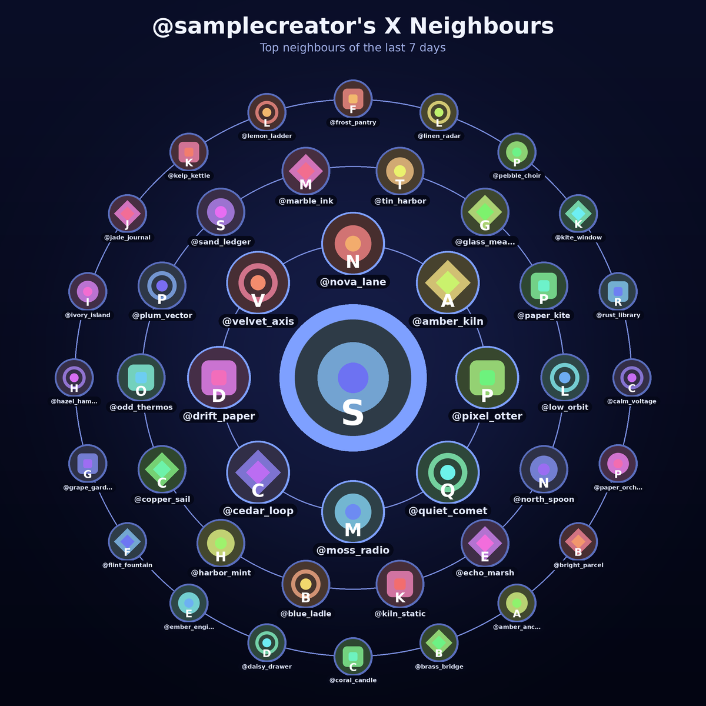

# X Neighbours

X Neighbours shows who liked and replied to an X account over the **last 7 days**. It tags each person (mutual, follows you, you follow, or neither), suggests follow-backs, and draws a square picture: your avatar in the centre, your closest neighbours in three rings around you. The last 24 hours is the same picture again, on the daily run.

A bot does the reading on X and saves the responses. `x_neighbours.py` turns those files into a markdown report and a PNG. The run is read-only. It does not follow, like, post, or send messages.



*Sample picture, midnight theme, three rings, rendered from the fictional dataset in `examples/sample`. Every handle and avatar on it was invented for this repo.*

The inner ring is the closest neighbours for that window, starting at the top and moving clockwise. The next rings step outward. Handles sit under the avatars.

## Setup

Python 3.9 or newer, and [Pillow](https://pypi.org/project/Pillow/).

```bash
git clone https://github.com/Skybatan/x-neighbours.git
cd x-neighbours
python3 -m pip install -r requirements.txt
cp config.example.json config.json
```

Edit `config.json` and set `handle` and `user_id` from the connected X account (`get_users_me`, or `get_users_by_username` for that same account). Follower and following lists come from the connected account, so the handle has to be that account.

```bash
python3 x_neighbours.py --help
python3 x_neighbours.py --now 2026-11-04T18:00:00Z
```

`--now` is the UTC time you started fetching. The script writes, for each window in config:

| File | What it is |
|---|---|
| `report_week.md` | Top likers, top repliers, follow-back suggestions. `report_day.md` when the day window is on |
| `x_neighbours_week.png` | The picture. `x_neighbours_day.png` when the day window is on |

It also prints a short JSON summary to stdout. In the sample week, that summary names `@pixel_otter` as the top liker and `@nova_lane` as the top replier.

A Grok Bot that runs this for its owner should follow [BOT.md](BOT.md) (the same runbook is in [skills/x-neighbours/SKILL.md](skills/x-neighbours/SKILL.md)).

## Config

`config.example.json`:

```json
{
  "handle": "your_handle",
  "user_id": "your_user_id",
  "like_weight": 1,
  "reply_weight": 3,
  "exclude": ["grok"],
  "rings": 3,
  "impressions": true,
  "show_names": true,
  "theme": "midnight",
  "windows": ["week"],
  "top": 10,
  "report": "both",
  "per_post": false,
  "per_day": false
}
```

| Key | Meaning |
|---|---|
| `handle` | Your X handle, without @ |
| `user_id` | Your numeric X user id, stored as a string |
| `like_weight`, `reply_weight` | Points per like and per reply. They order the picture and the follow-back list. The liker and replier tables stay in raw count order and include each person's combined score. These two numbers are a quiet setting: they are not drawn on the picture and they are not written in the report headings. Override them with `--like-weight` and `--reply-weight` |
| `exclude` | Handles to leave out of the rankings and the picture, such as bots. `@grok` is the default. `--exclude ''` clears the list |
| `rings` | Rings on the picture, from 1 to 4. Default 3. The rings hold 8, then 14, then 20, then 26 people |
| `impressions` | Show total impressions from your own posts, the change from the previous window when those posts were saved, and the top 3 posts. On by default. `--no-impressions` hides it |
| `show_names` | Draw handles under the avatars. `--hide-names` turns them off |
| `theme` | `midnight` (deep blue, the default), `light`, or `sunset` (purple into orange) |
| `windows` | `week` by default. `day`, or `day` and `week` together, when you want the last 24 hours as well |
| `top` | Rows in the top-likers and top-repliers tables |
| `report` | `both` (default), `likes`, or `replies`. `likes` and `replies` drop the other ranking |
| `per_post` | Add who liked or replied to each post. Off unless you ask |
| `per_day` | Add a day-by-day breakdown. Off unless you ask |

Other flags: `--config`, `--data`, `--out`, `--now`, `--rings`, `--top`, `--theme`, `--windows day,week`, `--report likes`, `--per-post`, `--per-day`, `--no-impressions`, `--show-names`, `--no-image`.

A plain run is the week picture plus both rankings, with impressions included. Likes only, replies only, per post, and per day are there when you pass the flags. They read the files already in `data/` and do not call X.

Impressions come from `public_metrics.impression_count` on your own posts. That field is already in the posts fetch. The report sums the current window, compares it with the previous window when those older posts are in `data/`, and links the top 3. Viewers do not have impression counts, so nothing else is requested.

```bash
python3 x_neighbours.py --now 2026-11-04T18:00:00Z --report likes
python3 x_neighbours.py --now 2026-11-04T18:00:00Z --report replies
python3 x_neighbours.py --now 2026-11-04T18:00:00Z --per-post
python3 x_neighbours.py --now 2026-11-04T18:00:00Z --per-day
python3 x_neighbours.py --now 2026-11-04T18:00:00Z --windows day,week
```

`config.json` stays on your machine. It is listed in `.gitignore`.

## Collecting the data

Save each tool result as JSON under `data/`. From the repo directory:

```bash
python3 save_raw.py <tool-result-file> <name>
```

`save_raw.py` accepts raw JSON or text that wraps one JSON object, and writes `data/<name>.json`. You can also write that file yourself if you already have the object.

Pick a UTC timestamp `T` when you start. Pass `T` to the script as `--now`. For a week (or for both windows), `start_time` is `T` minus 7 days, for example `T` = `2026-11-04T18:00:00Z` and `start_time` = `2026-10-28T18:00:00Z`. For a day-only run, `start_time` is `T` minus 24 hours. One fetch feeds every window you render: the script cuts the 24-hour window out of the same files.

`{ID}` is your user id. Page with `pagination_token` set to the previous `meta.next_token`, and stop when there is no next token. Pages can be shorter than `max_results`.

| # | Tool | Arguments | Save as |
|---|---|---|---|
| 1 | `get_users_posts` | `id={ID}`, `start_time=START`, `exclude=retweets`, `max_results=100`, `post.fields=created_at,public_metrics,in_reply_to_user_id,referenced_tweets`, `expansions=author_id`, `user.fields=username,name,profile_image_url,public_metrics` | `posts_1`, `posts_2`, … |
| 2 | `get_users_mentions` | `id={ID}`, `start_time=START`, `max_results=100`, `post.fields=created_at,author_id,in_reply_to_user_id,referenced_tweets,conversation_id`, `expansions=author_id`, `user.fields=username,name,description,public_metrics,profile_image_url` | `mentions_1`, `mentions_2`, … |
| 3 | `get_posts_liking_users` | For each of your posts with likes: `id=<post id>`, `max_results=100`, `user.fields=username,name,description,public_metrics,profile_image_url` | `likes_<postid>`, then `likes_<postid>_p2` if you fetch another page |
| 4 | `get_users_me_followers` and `get_users_me_following` | `max_results=1000`, `user.fields=username,name,description,public_metrics,profile_image_url`. Reuse the files when they are under 7 days old | `followers_1`, … and `following_1`, … |

On a Grok Bot these tools are on the X connection. Call each tool by name. A reply counts when `in_reply_to_user_id` is `{ID}`, or when a `replied_to` reference points at one of your posts. Your own posts are ignored. `public_metrics.impression_count` on those posts is the impressions total. No other call is needed for it.

### Keeping the read count down

Stay around **30 calls a minute** and **1,000 calls a day**. Send about 12 calls, then pause.

Liker lists are the expensive step, one call per post:

- The last 24 hours: every post with at least one like.
- Days 2–7: only posts with 3 or more likes. The posts you skip are usually short replies liked by one or two people.
- One page of 100 likers is enough for almost every post. Fetch another page only when `meta.next_token` is present and you still have room in the day's budget.

Follower and following lists are long. Refresh them on the Monday run, and reuse them on the daily runs. A day run is posts, mentions, and that day's liker lists. On Monday the week run reuses that morning's daily files and only fetches the earlier part of the week. The two runs together stay inside the daily cap. The steps are in [BOT.md](BOT.md).

The report's Notes section counts liker lists that came back shorter than the like count (deleted, suspended, or protected accounts) and posts whose likers were not fetched.

## Try the sample

The files in `examples/sample` are fictional: invented people, invented posts, and geometric avatars generated by `examples/make_sample.py`. The render does not use the network. The timestamps are frozen, so pass `--now`.

```bash
python3 x_neighbours.py \
  --config config.example.json \
  --handle samplecreator \
  --user-id 900001 \
  --data examples/sample \
  --out /tmp/x-neighbours-sample \
  --now 2026-11-04T18:00:00Z
```

That writes `/tmp/x-neighbours-sample/x_neighbours_week.png`, which is the picture at the top of this file, and `report_week.md`. Add `--windows day,week` for the last 24 hours as well, or `--per-post` / `--per-day` for the optional breakdowns. Rebuild the dataset with `python3 examples/make_sample.py`.

## Privacy

- `config.json`, `data/`, `.avatar_cache/`, `report_*.md`, and `x_neighbours_*.png` are gitignored. Leave them that way.
- Real avatars are downloaded from the `profile_image_url` values in the saved JSON into `.avatar_cache/` next to the output folder.
- Do not commit a creator's config, raw responses, avatar cache, reports, or pictures, and do not open a pull request that contains them.
- The sample dataset is the only account data in this repo, and it is not from X.

## Layout

| Path | Role |
|---|---|
| `x_neighbours.py` | Reports and pictures |
| `save_raw.py` | Store one tool result under `data/` |
| `config.example.json` | Config template |
| `BOT.md`, `skills/x-neighbours/SKILL.md` | Runbook for the bot |
| `examples/sample/` | Fictional data and generated avatars |
| `docs/sample-neighbours.png` | The sample picture used above |
