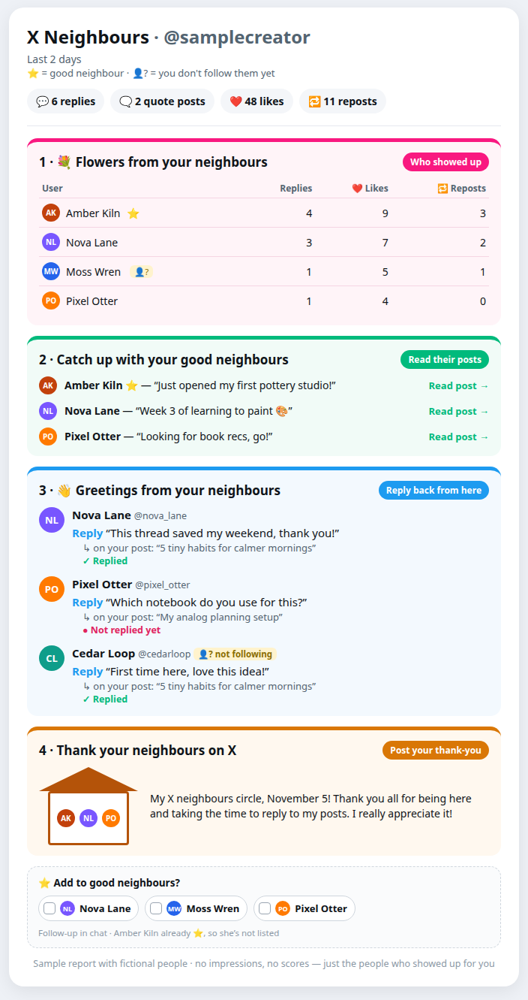
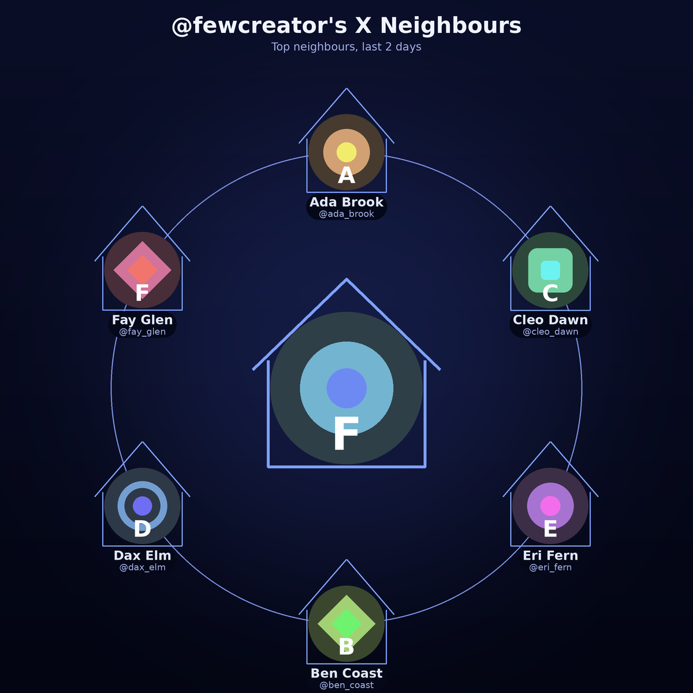
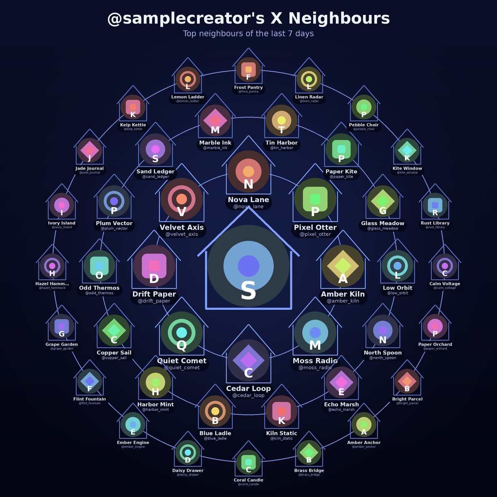

# X Neighbours

[](https://github.com/Skybatan/x-neighbours/actions/workflows/tests.yml)

X Neighbours helps a creator catch up with the people who replied, quoted, liked, and reposted. The report is a Page with the same sections as the short markdown report. The chat gets a one-line headline and the Page link. A report-card PNG is optional (`--report-card`). A bot does the reading on X. The script only reads the saved JSON. It does not follow, like, post, or send messages.

## Contributors

A big thank you to everyone who has helped make X Neighbours better 💐 New neighbours are always welcome: share an idea, report a bug, or pick up an [issue](https://github.com/Skybatan/x-neighbours/issues) and open a pull request. The steps are in [CONTRIBUTING.md](CONTRIBUTING.md).

- [RonySpark](https://github.com/RonySpark) ([@ronyspark](https://x.com/ronyspark)) — first contribution, [#19](https://github.com/Skybatan/x-neighbours/pull/19): the week-report crash fix on ISO timestamps, the one-row-per-person waiting list, `referenced_posts` support, the paging docs, and the offline tests.



*Sample report with fictional people.*

The first report is a short demo: the latest original posts and quotes (`trial_post_count`, default 5), not a day window, and about 15 X reads. The header says `First report`. Every report includes the house-framed picture and a thank-you link. With only a few neighbours the picture uses one larger ring instead of an empty three-ring chart.



*Made-up neighbours, one ring, house frames. The display name sits under each avatar, with the @username below it. From `examples/few`.*

People the owner does not follow are marked 👤? once a following list has been loaded. The first report skips that list, so it does not show 👤? or that legend. There is no followed/unfollowed split. Catch up with your good neighbours lists each person's latest original post (not a reply or a plain repost; a quote of their own counts) that the owner has not already liked, replied to, reposted, or quoted. The age is that post's `created_at` against the current UTC time. People with none left in the saved page are skipped. If nothing is left to show, the section says you're all caught up. When the owner has a good neighbours list, that section shows only those people. When the list is empty, it stays the top people from the period and adds one hint line. A ⭐ marks a good neighbour in the other sections too. The ordering score stays in config and is not printed.

The thank-you sentence is “My X neighbours circle, November 5!” plus a short thanks, using the report date in `timezone` (UTC if that key is blank). It does not mention any username. Community mode, which is off unless the owner opts in, adds one reminder to tag @SkyXFunNext when they post the picture. The bot still does not post it. Individual mode does not add that line.

Every report has four parts, written so a phone can read them without sideways scrolling. The header is two lines: the period (`Since your last report · 30 min ago`, `Last 24 hours`, `Last 7 days`, or `First report`), then emoji counts only (`💬 3 · 🔁💬 0 · ❤️ 0 · 🔁 0`). The sections are 💐 Flowers, 🏡 What's new, 👋 Replies, then Thank your neighbours on X. The first three show five entries and say how many are left. The bot delivers that report as a Page. The chat message is a short headline (the counts, and how many replies need an answer) and the Page link. The house-framed picture is attached to that short message. The thank-you words and the link are on the Page. The link does not attach the picture; the owner saves it and attaches it in X. Profile photos are kept as metadata and are not placed on the Page. The original three-ring layout is unchanged, and every avatar, including the centre, sits in a simple house frame. `--no-picture` skips the image.



*Same fictional neighbourhood. Inner ring from the top, clockwise. The display name sits under each avatar, with the @username on the line below.*

## Setup

Python 3.9 or newer, and [Pillow](https://pypi.org/project/Pillow/).

```bash
git clone https://github.com/Skybatan/x-neighbours.git
cd x-neighbours
python3 -m pip install -r requirements.txt
cp config.example.json config.json
```

Edit `config.json` and set `handle` and `user_id` from the connected X account (`get_users_me`, or `get_users_by_username` for that same account). Follower and following lists come from the connected account, so the handle has to be that account.

```bash
python3 x_neighbours.py --help
python3 x_neighbours.py --now 2026-11-04T18:00:00Z
```

`--now` is the UTC time you started fetching. The script writes, for each window in config:

| File | What it is |
|---|---|
| `report_week.md` | Sections 1–3, the plain-text fallback. `report_day.md` for a day, `report_first.md` for the first run, `report_fresh.md` since the last report |
| `report_*_thanks.md` | Section 4, the thank-you text and link, for that fallback |
| `report_*.canvas.tsx` | The Page. `report_page.py` fills `templates/report.canvas.tsx` |
| `x_neighbours_*.png` | The house-framed picture, attached to the short chat message |

A Grok Bot that runs this for its owner should follow [skills/x-neighbours/SKILL.md](skills/x-neighbours/SKILL.md) after the first report. The first report is [skills/x-neighbours/FIRST_RUN.md](skills/x-neighbours/FIRST_RUN.md). [BOT.md](BOT.md) only points at those files. The getting-started skill points at that file. Any concern in chat can become a short GitHub issue: the bot drafts it and hands over a prefilled link, once per topic, and the owner submits it. The Monday report ends with one line inviting that. The draft leaves out handles, names, and post text. A contributor's bot that changes this repo follows [skills/x-neighbours-maintain/SKILL.md](skills/x-neighbours-maintain/SKILL.md).

## Version

The version number is the single line in [`VERSION`](VERSION). `version.py` reads that file. This README does not copy the number.

```bash
python3 version.py
python3 x_neighbours.py --version
```

What changed is in [CHANGELOG.md](CHANGELOG.md).

## Upgrading an installed bot

The clone and `config.json` stay where they are. The good neighbours list and the report clock stay in the bot store. Nothing pulls on a schedule.

Individual mode does not check `versions/` and does not download the global list. When the owner asks to update, use the steps below. Community mode asks first, on the Monday check, and runs these steps only after the owner says yes.

1. From the clone, run `python3 version.py` and keep the line.
2. `git pull --ff-only`. When `requirements.txt` changed, run `python3 -m pip install -r requirements.txt`. Leave `config.json` and `data/` uncommitted.
3. Run `python3 version.py` again. When the line changed, read [CHANGELOG.md](CHANGELOG.md).
4. Leave `good_neighbours.json`, `state.json`, `community.json`, and `global_neighbours.neighbours` in the bot store. The next report uses the updated scripts. Connect X again only when the X tools are missing.

## Community mode

Community mode is off by default. An individual bot keeps the local reports and the picture. It does not check for a new version, does not download recommendations, and does not open a share pull request.

An owner who joins gets:

- a Sunday reminder, in their report timezone, that they can share when 7 days have passed, and that a feature release may land on Monday
- a Monday check of `versions/latest.json` against the local `VERSION`. If the GitHub version is newer, the bot asks before `git pull`. It never upgrades in the background
- a local copy of `global/neighbours.global.neighbours`, saved on that Monday check as `global_neighbours.neighbours` in the bot store
- the option to share an eligible list, described in [RULES.md](RULES.md)
- a reminder, when they post the picture, to include @SkyXFunNext so it can be reposted. If that is already the posting account, the reminder is skipped

Leaving community mode stops those behaviours. A list already merged stays public until the person files an [opt-out](.github/ISSUE_TEMPLATE/opt-out.md).

The runbooks are [skills/x-neighbours-community/SKILL.md](skills/x-neighbours-community/SKILL.md) and [skills/x-neighbours-share/SKILL.md](skills/x-neighbours-share/SKILL.md).

## Shared recommendations

A share file is `submissions/<x user id>/<UTC timestamp>.neighbours`. JSON inside, one new file per pull request, at most once every 7 days. The score is the picture score: likes + reposts + 3 × (replies + quotes). The minimum is `max(8, ceil(50 × period_days / 90))` (50 over 90 days, 8 over 7). Replies plus quotes must be at least 2. The cap is 100. The default period is 90 days. An owner may use 7 to 93 days and may remove names. They cannot add people the counts did not produce.

The global file lists an account after two owners recommend it. `recommended_by` records who, when, and which file. Opt-outs and banned owners are applied on rebuild.

### Founding list

The global file is empty until submissions arrive. One path, set in `global/build.json` under `founding_waiver.submission`, may populate the list from a single file. That path is blank in this repo. After a new bot submits through the normal share flow and the file is merged, the maintainer sets `submission` to that exact path, keeps `owner_id` as `founding` and `owner_handle` as `founding-submission`, and labels the pull request `maintainer-waiver`. The submission file keeps that owner's real user id and handle, because the path is `submissions/<user id>/`. The displayed credit is the neutral identity from `build.json`, not the test bot and not a personal handle. There is no pre-made founding file in this repo. Any other file still needs two recommendations. Details are in [founding/README.md](founding/README.md).

### How reviews work

The Action “Validate share submissions” checks shape, size, the 7-day gap, eligibility math, self-listing, and notes. [Neighbour Dog](skills/neighbour-dog/SKILL.md) is a separate reviewer bot with its own GitHub account. It merges a clean share, rejects a clear failure, and flags borderline cases (a first-time owner, a spike, a possible boost ring, a new account) with the label `needs-maintainer`. It does not edit the global file. A rebuild Action writes `global/neighbours.global.neighbours` after merges. That rebuild can happen any day and does not change `versions/latest.json`.

`versions/latest.json` moves only on a Monday release. The maintainer runs the “Monday release” workflow, which refuses any other UTC weekday. It reads the number from `VERSION`, writes `versions/latest.json` and `versions/<version>.json`, tags, and opens a GitHub Release. The bot’s Monday message is the announcement owners see. There is no mailing list.

### What the maintainer configures

These are not in the repo, because they are accounts and secrets:

1. A GitHub account for Neighbour Dog, with Write or Maintain on this repo, so reviews are not under a personal account. Create the labels `needs-maintainer` and `maintainer-waiver`.
2. A fine-grained personal access token for that account (contents and pull requests). Store it as the Actions secret `NEIGHBOUR_DOG_TOKEN`. Until it is set, the Neighbour Dog workflow still prints a decision and does not merge. The validate check still runs.
3. Branch protection on `main`: require the check “Validate share submissions”. Let Neighbour Dog merge share pull requests that pass. Do not require a personal review on those. Allow `github-actions[bot]` to push `global/neighbours.global.neighbours`, or the rebuild workflow cannot commit. Code pull requests stay for the owner to review.
4. Optional: `X_NEIGHBOURS_GITHUB_TOKEN` on a community owner’s bot, so that bot can open the share pull request. Without it, the bot writes the file and the owner opens the pull request. Do not use a personal maintainer token for that if the pull request should not show a personal account.
5. The first founding submission is flagged as a first-time owner. The maintainer reviews it, merges it, then sets the waiver path as above.

### Try it with a new bot

1. Install a new bot from the current `main`, or from `v3` while that branch is the one under test. Set `share_branch` in `config.json` to the same branch (or pass `--base`). Then opt in.
2. On the first report the bot asks once about community mode. Say yes.
3. Run reports until `data/` has real interactions. Ask the bot to share. The default window is 90 days. A short test can ask for 7 days when that week meets the lower bar (score at least 8, and at least two replies or quotes).
4. Post the one-time code from the X account yourself. Give the bot the post id. The bot does not post.
5. Open the pull request (the bot does this when `X_NEIGHBOURS_GITHUB_TOKEN` is set; otherwise take the file it wrote). It must be the only new file, under `submissions/<user id>/`.
6. Wait for the validate check. Neighbour Dog flags a first-time owner, so review that pull request and merge it yourself if it looks right.
7. The rebuild leaves the global list unchanged, because one owner is not enough while the waiver path is empty. Confirm the new account is absent.
8. Set `founding_waiver.submission` to that exact file path. Keep the neutral `owner_id` and `owner_handle`. Label the pull request `maintainer-waiver` and merge it.
9. The rebuild loads that one file. Those neighbours appear with `source` `founding` and `recommended_by` the neutral identity. A second bot’s new name stays out until another owner lists it too.
10. On Monday, a community bot compares versions and, if nothing is newer, just refreshes `global_neighbours.neighbours` in its store. Posting the picture reminds the owner to tag @SkyXFunNext.

## Config

`config.example.json`:

```json
{
  "handle": "your_handle",
  "user_id": "your_user_id",
  "like_weight": 1,
  "reply_weight": 3,
  "exclude": ["grok"],
  "rings": 3,
  "show_names": true,
  "first_run_days": 2,
  "trial_post_count": 5,
  "items_per_user": 3,
  "theme": "midnight",
  "windows": ["week"],
  "top": 10,
  "report": "both",
  "per_post": false,
  "per_day": false,
  "timezone": "",
  "share_branch": ""
}
```

| Key | Meaning |
|---|---|
| `handle` | Your X handle, without @ |
| `user_id` | Your numeric X user id, stored as a string |
| `like_weight`, `reply_weight` | Quiet points. A reply or quote uses `reply_weight`. A like uses `like_weight`. They order Catch up and the picture. They are not printed on the report or the picture. Override with `--like-weight` and `--reply-weight` |
| `exclude` | Handles left out, such as bots. `@grok` is the default |
| `rings` | Rings on the picture, from 1 to 4. Default 3. The rings hold 8, then 14, then 20, then 26 people |
| `trial_post_count` | How many of the latest original posts and quotes the first report uses. Default 5. No day window. Replies are left out. The read budget is about 15 |
| `first_run_days` | Not used by the first report. An older config can still contain it |
| `items_per_user` | Reply and quote lines shown per person before `+N more`. Default 3 |
| `show_names` | Display name under each avatar, with @username on the line below. @username alone when the account has no name |
| `theme` | `midnight` (default), `light`, or `sunset` |
| `windows` | `week` by default. `day` is the daily report |
| `top` | How many people are ranked for Flowers and for Catch up when the good neighbours list is empty. The chat still shows five at a time. Default 10 |
| `timezone` | IANA name for the thank-you date and the Sunday reminder, such as `Europe/Stockholm`. Blank means UTC. Monday release times in `versions/` are UTC |
| `share_branch` | Branch for the Monday raw URLs and for a share pull request. Blank uses the checked-out branch, then `main`. Set `v3` to target that branch. Community mode itself is not a config key. It lives in `community.json` in the bot store, default off |
| `fresh_hours` | Optional. How many hours until the bot may offer a new report. Omit it and the bot estimates: 1 hour at 60 or more interactions a day, 3 hours from 15 to 59, 8 hours under 15 |
| `good_neighbours` | Optional path to the personal list. Prefer `--good-neighbours`, because the file lives outside the repo. A missing file is an empty list. At most 20 people |
| `report` | `both` (default), `likes`, or `replies` |
| `per_post`, `per_day` | Extra markdown sections. Off unless you ask |

Other flags: `--config`, `--data`, `--out`, `--now`, `--since`, `--days`, `--first-run`, `--trial-plan`, `--estimate-reads`, `--trial-post-count`, `--report-card`, `--rings`, `--top`, `--theme`, `--windows day,week`, `--report likes`, `--per-post`, `--per-day`, `--picture`, `--no-picture`, `--show-names`, `--no-image`, `--good-neighbours PATH`, `--state PATH`, `--timezone`, `--fresh-hours`, `--version`.

A plain run writes the markdown report and the neighbours picture. `--first-run` is the first report (`trial_post_count` latest originals and quotes). The header is `First report`. `--trial-plan` prints the reads for posts already saved. `--estimate-reads N` prints how many minutes those reads should take. `--report-card` adds the PNG card. `--days 14` is a custom period. `--no-picture` skips the image.

```bash
python3 x_neighbours.py --now 2026-11-04T18:00:00Z --report likes
python3 x_neighbours.py --now 2026-11-04T18:00:00Z --report replies
python3 x_neighbours.py --now 2026-11-04T18:00:00Z --per-post
python3 x_neighbours.py --now 2026-11-04T18:00:00Z --per-day
python3 x_neighbours.py --now 2026-11-04T18:00:00Z --windows day,week
```

`config.json` stays on your machine. It is listed in `.gitignore`.

## Collecting the data

Save each tool result as JSON under `data/`. From the repo directory:

```bash
python3 save_raw.py <tool-result-file> <name>
```

`save_raw.py` accepts raw JSON or text that wraps one JSON object, and writes `data/<name>.json`. You can also write that file yourself if you already have the object.

Pick a UTC timestamp `T` when you start: the actual current UTC time, not a leftover from an earlier run. Pass `T` to the script as `--now`. What's new ages posts from each `created_at` against the clock at render time, not from `--now`. For a week (or for both windows), `start_time` is `T` minus 7 days, for example `T` = `2026-11-04T18:00:00Z` and `start_time` = `2026-10-28T18:00:00Z`. For a day-only run, `start_time` is `T` minus 24 hours. One fetch feeds every window you render: the script cuts the 24-hour window out of the same files.

`{ID}` is your user id. Always pass `max_results` 100 for posts, mentions, and likers; do not omit it (the tool then pages at 25). Page with `pagination_token` set to the previous `meta.next_token`. Keep paging while `next_token` is present — a short page is not the end of the list. For mentions, keep calling until there is no `next_token`.

| # | Tool | Arguments | Save as |
|---|---|---|---|
| 1 | `get_users_posts` | `id={ID}`, `start_time=START`, `exclude=retweets` (do not exclude replies), `max_results=100`, `post.fields=created_at,public_metrics,in_reply_to_user_id,referenced_tweets,conversation_id`, `expansions=author_id,referenced_posts`, `user.fields=username,name,profile_image_url,public_metrics` | `posts_1`, `posts_2`, … |
| 2 | `get_users_mentions` | `id={ID}`, `start_time=START`, `max_results=100`, `post.fields=created_at,author_id,text,in_reply_to_user_id,referenced_tweets,conversation_id`, `expansions=author_id,referenced_posts`, `user.fields=username,name,description,profile_image_url`. Save `includes` too | `mentions_1`, … |
| 3 | `get_posts_liking_users` | Original posts and quotes with likes. Never the owner's replies. `user.fields=username,name,description,profile_image_url` | `likes_<postid>` |
| 4 | `get_posts_reposted_by` | Posts with reposts. Same user fields | `reposts_<postid>` |
| 5 | `get_posts_quoted_posts` | Posts with quotes. `post.fields=created_at,author_id,text,referenced_tweets`, `expansions=author_id` | `quotes_<postid>` |
| 6 | `get_users_liked_posts` and `get_users_posts` | Owner only, before Catch up. Likes: `max_results=20`, at most two pages, saved as `my_likes_1` and `my_likes_2`. Own posts: `max_results=20`, no `exclude`, one page, `post.fields` include `referenced_tweets,conversation_id`, `expansions=author_id,referenced_posts`, saved as `my_posts_1`. A failed call is skipped. Those replies are how Replies marks a mention answered | `my_likes_1`, `my_posts_1` |
| 7 | `get_users_posts` | Each good neighbour (at most 20), or at most 10 catch-up people when the list is empty. `max_results=100`, `exclude` `replies` and `retweets`, `post.fields=created_at,text,conversation_id`, `expansions=author_id,in_reply_to_user_id,referenced_posts`. One more page as `latest_<userid>_p2` if the first page is all engaged | `latest_<userid>` |
| 8 | `get_users_me_followers` and `get_users_me_following` | `max_results=1000`. Refresh on Mondays | `followers_1`, `following_1`, … |

On a Grok Bot these tools are on the X connection. A reply counts only when its direct `replied_to` parent is one of your original posts or quotes, not one of your replies. `conversation_id` and `in_reply_to_user_id` are not enough on their own: a later reply in the same thread shares both. A quote of your post still counts. You have answered a reply when one of your own replies points `replied_to` at that reply's id. Your own posts are ignored as neighbours. Likers are fetched for original posts and quotes only, never for your replies. The picture score and the share check use that same reply count.

### Keeping the read count down

Stay around **30 calls a minute** and **1,000 calls a day**. Send independent reads in parallel batches of up to 12, and stay under 30 a minute.

Likes, reposts, and quotes are one call per post:

- Likers: original posts and quotes only. Never the owner's replies. The last 24 hours and `like_count` greater than 0, or days 2–7 and `like_count` at least 3.
- Reposts and quote posts: every post, including replies. The last 24 hours: every post with that count above 0. Days 2–7: only counts of 3 or more.
- Latest posts: one call per good neighbour (at most 20), or at most 10 when that list is empty. If that page is already all engaged, fetch one more page.
- Already-engaged posts: at most two like pages and one page of the owner's own posts. Reuse them for the rest of the day. A failed call does not stop the report.
- One page is enough for almost every post. Fetch another page only while you are inside the day's budget.

Follower lists refresh on Monday only. The Monday run reuses that morning's daily files and only fetches the earlier part of the week, including likes, reposts, and quotes. The two runs share the 1,000-read cap. The steps are in [skills/x-neighbours/SKILL.md](skills/x-neighbours/SKILL.md).

## Try the sample

The files in `examples/sample` are fictional: invented people, invented posts, and geometric avatars generated by `examples/make_sample.py`. The render does not use the network. The timestamps are frozen, so pass `--now`.

```bash
python3 x_neighbours.py \
  --config config.example.json \
  --handle samplecreator \
  --user-id 900001 \
  --data examples/sample \
  --out /tmp/x-neighbours-sample \
  --now 2026-11-04T18:00:00Z
```

A short first-run sample, five fictional neighbours:

```bash
python3 x_neighbours.py \
  --config config.example.json \
  --handle fewcreator \
  --user-id 800001 \
  --data examples/few \
  --out /tmp/x-neighbours-few \
  --now 2026-11-04T18:00:00Z \
  --first-run
```

That writes `report_first.md`, `report_first.canvas.tsx`, and `x_neighbours_first.png` (the picture above). The same data with a fictional list:

```bash
python3 x_neighbours.py \
  --config config.example.json \
  --handle fewcreator \
  --user-id 800001 \
  --data examples/few \
  --good-neighbours examples/few/good_neighbours.json \
  --out /tmp/x-neighbours-few \
  --now 2026-11-04T18:00:00Z \
  --windows day
```

`examples/few/sample-report.md` is sections 1–3 of that daily report: Flowers, then Catch up with your good neighbours, then Greetings. `examples/few/sample-thanks.md` is section 4. The ⭐ Add card is separate and only lists Flowers people who are not on the list. Rebuild both datasets with `python3 examples/make_sample.py`. The list file is not rewritten by that script. Add someone with `python3 good_neighbours.py --file PATH add handle --id ID --name "Name"`. The freshness clock is `python3 report_state.py --file PATH check`.

GitHub Actions runs `python3 -m unittest discover -s tests -v` and this offline report (the bundled fixtures under `tests/fixtures/offline` and the samples under `examples/`) on every pull request and on pushes to `main`. The job installs `requirements.txt`. It does not call X and does not use secrets.

## Privacy

- `config.json`, `data/`, `.avatar_cache/`, `report_*.md`, `report_*.png`, `report_*.canvas.tsx`, `report_*_page.json`, `x_neighbours_*.png`, and a `good_neighbours.json`, `state.json`, `community.json`, or `global_neighbours.neighbours` copied into the repo root are gitignored. Leave them that way. The real list, the report clock, and community mode belong in the bot's store, not in this repo. `examples/few/good_neighbours.json` is fictional and is the only copy that is tracked. Public share files under `submissions/` are the exception, and they go through a pull request.
- Real avatars are downloaded from the `profile_image_url` values in the saved JSON into `.avatar_cache/` next to the output folder.
- Do not commit a creator's config, raw responses, avatar cache, reports, or pictures, and do not open a pull request that contains them.
- The sample dataset is the only account data in this repo, and it is not from X.

## Layout

| Path | Role |
|---|---|
| `x_neighbours.py` | Reports and pictures. `--version` prints the line in `VERSION` |
| `VERSION` | The only copy of the version number |
| `version.py` | Read that number. Code calls `version.version()` |
| `CHANGELOG.md` | What changed, for anyone upgrading |
| `good_neighbours.py` | Add, remove, or list the personal good neighbours file |
| `report_state.py` | Read or update the freshness clock in the bot store |
| `feedback_link.py` | Build a prefilled GitHub issue link. It does not post the issue |
| `.github/ISSUE_TEMPLATE/feedback.md` | Issue template labelled `feedback` |
| `CONTRIBUTING.md` | Shared process for issues and pull requests |
| `.github/pull_request_template.md` | Checklist on every pull request |
| `save_raw.py` | Store one tool result under `data/` |
| `config.example.json` | Config template |
| `skills/x-neighbours/SKILL.md` | Runbook for the bot |
| `BOT.md` | Pointer to that runbook |
| `skills/x-neighbours-maintain/SKILL.md` | How a contributor's bot changes this repo |
| `skills/x-neighbours-community/SKILL.md` | Opt-in community mode, Sunday reminder, Monday check |
| `skills/x-neighbours-share/SKILL.md` | Share an eligible list |
| `skills/neighbour-dog/SKILL.md` | Review and merge share pull requests |
| `RULES.md` | Eligibility and share rules |
| `rules.py`, `rules.json` | The same rules, for the checker |
| `share_submission.py` | Build and validate a `.neighbours` file |
| `global_build.py` | Rebuild the global list. Does not touch `versions/` |
| `community.py` | Join, leave, reminders, version check, local save |
| `neighbour_dog.py` | Merge, reject, or flag decision |
| `versions_release.py` | Write `versions/latest.json` on Monday only |
| `global/build.json` | Two-recommendation rule and the one founding waiver path |
| `global/neighbours.global.neighbours` | Rebuilt recommendation list |
| `versions/latest.json` | Monday release pointer |
| `submissions/` | Public share files, one new file per pull request |
| `founding/README.md` | How to point the waiver once a file exists |
| `opted-out/` | Accounts removed from the global list |
| `schemas/` | JSON shapes for a submission, the global list, and a release |
| `examples/sample/` | Fictional data and generated avatars |
| `docs/sample-report.png` | Sample report picture, fictional people |
| `docs/sample-report.html` | HTML source for that picture |
| `docs/sample-few-neighbours.png` | First-run picture with fictional neighbours |
| `docs/sample-neighbours.png` | A full three-ring picture from `examples/sample` |
| `examples/few/` | The short fictional dataset |
| `examples/few/good_neighbours.json` | Fictional good neighbours list |
| `examples/few/sample-report.md` | Sections 1–3 of a daily report from that list |
| `examples/few/sample-thanks.md` | Section 4, the thank-you with no usernames |
