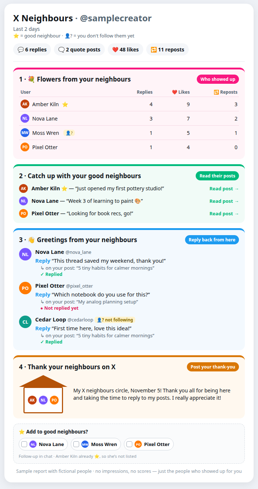
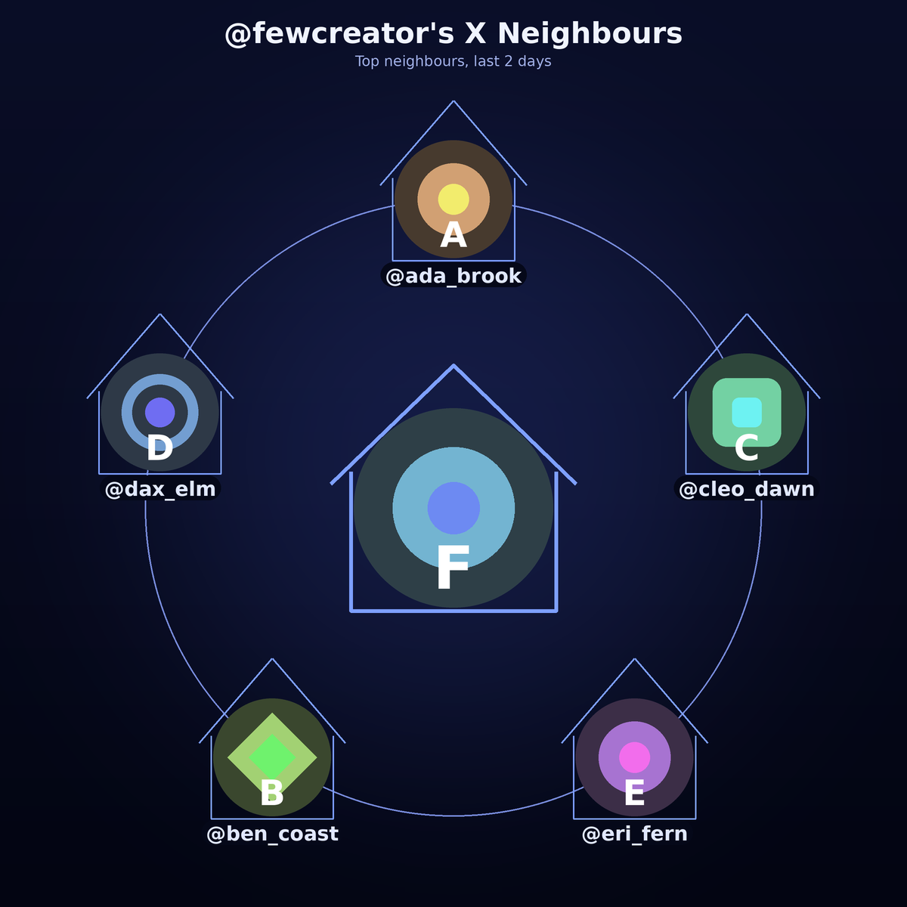

# X Neighbours

X Neighbours helps a creator catch up with the people who replied, quoted, liked, and reposted. The default result is a short chat report (markdown). A report-card PNG is optional (`--report-card`). A bot does the reading on X. The script only reads the saved JSON. It does not follow, like, post, or send messages.



*Sample report with fictional people.*

The first run covers the last two days, so it loads quickly. Every report includes the house-framed picture and a thank-you link. With only a few neighbours the picture uses one larger ring instead of an empty three-ring chart.



*Five made-up neighbours, one ring, house frames. From `examples/few`.*

People the owner does not follow are marked 👤?. There is no followed/unfollowed split. Catch up with your good neighbours lists each person's latest original post (not a reply or a plain repost; a quote of their own counts). People with none in the saved page are skipped. When the owner has a good neighbours list, that section shows only those people. When the list is empty, it stays the top people from the period and adds one hint line. A ⭐ marks a good neighbour in the other sections too. The ordering score stays in config and is not printed.

The thank-you sentence is “My X neighbours circle, November 5!” plus a short thanks, using the report date in `timezone` (UTC if that key is blank). It does not mention any username.

Every report has four parts: Flowers from your neighbours, Catch up with your good neighbours, Greetings from your neighbours, then Thank your neighbours on X. The house-framed picture sits in that last part, with a ready-to-post thank-you that names nobody. The original three-ring layout is unchanged, and every avatar, including the centre, sits in a simple house frame. `--no-picture` skips the image.


*Same fictional neighbourhood. Inner ring from the top, clockwise. Handles sit under the avatars.*

## Setup

Python 3.9 or newer, and [Pillow](https://pypi.org/project/Pillow/).

```bash
git clone https://github.com/Skybatan/x-neighbours.git
cd x-neighbours
python3 -m pip install -r requirements.txt
cp config.example.json config.json
```

Edit `config.json` and set `handle` and `user_id` from the connected X account (`get_users_me`, or `get_users_by_username` for that same account). Follower and following lists come from the connected account, so the handle has to be that account.

```bash
python3 x_neighbours.py --help
python3 x_neighbours.py --now 2026-11-04T18:00:00Z
```

`--now` is the UTC time you started fetching. The script writes, for each window in config:

| File | What it is |
|---|---|
| `report_week.md` | Sections 1–3. `report_day.md` for a day, `report_first.md` for the first run, `report_fresh.md` since the last report |
| `report_*_thanks.md` | Section 4, the thank-you text and link. The picture is sent in the same chat message |
| `x_neighbours_*.png` | The house-framed picture, included inside section 4 |

A Grok Bot that runs this for its owner should follow [BOT.md](BOT.md) (the same runbook is in [skills/x-neighbours/SKILL.md](skills/x-neighbours/SKILL.md)).

## Config

`config.example.json`:

```json
{
  "handle": "your_handle",
  "user_id": "your_user_id",
  "like_weight": 1,
  "reply_weight": 3,
  "exclude": ["grok"],
  "rings": 3,
  "show_names": true,
  "first_run_days": 2,
  "items_per_user": 3,
  "theme": "midnight",
  "windows": ["week"],
  "top": 10,
  "report": "both",
  "per_post": false,
  "per_day": false,
  "timezone": ""
}
```

| Key | Meaning |
|---|---|
| `handle` | Your X handle, without @ |
| `user_id` | Your numeric X user id, stored as a string |
| `like_weight`, `reply_weight` | Quiet points. A reply or quote uses `reply_weight`. A like uses `like_weight`. They order Catch up and the picture. They are not printed on the report or the picture. Override with `--like-weight` and `--reply-weight` |
| `exclude` | Handles left out, such as bots. `@grok` is the default |
| `rings` | Rings on the picture, from 1 to 4. Default 3. The rings hold 8, then 14, then 20, then 26 people |
| `first_run_days` | How many days the first fetch covers. Default 2. Daily stays 24 hours. Monday stays 7 days |
| `items_per_user` | Reply and quote lines shown per person before `+N more`. Default 3 |
| `show_names` | Handles under the avatars on the picture |
| `theme` | `midnight` (default), `light`, or `sunset` |
| `windows` | `week` by default. `day` is the daily report |
| `top` | Rows in Flowers (user, replies, likes, reposts), and people in Catch up when the good neighbours list is empty. Default 10 |
| `timezone` | IANA name for the thank-you date, such as `Europe/Stockholm`. Blank means UTC |
| `fresh_hours` | Optional. How many hours until the bot may offer a new report. Omit it and the bot estimates: 1 hour at 60 or more interactions a day, 3 hours from 15 to 59, 8 hours under 15 |
| `good_neighbours` | Optional path to the personal list. Prefer `--good-neighbours`, because the file lives outside the repo. A missing file is an empty list. At most 20 people |
| `report` | `both` (default), `likes`, or `replies` |
| `per_post`, `per_day` | Extra markdown sections. Off unless you ask |

Other flags: `--config`, `--data`, `--out`, `--now`, `--since`, `--days`, `--first-run`, `--report-card`, `--rings`, `--top`, `--theme`, `--windows day,week`, `--report likes`, `--per-post`, `--per-day`, `--picture`, `--no-picture`, `--show-names`, `--no-image`, `--good-neighbours PATH`, `--state PATH`, `--timezone`, `--fresh-hours`.

A plain run writes the markdown report and the neighbours picture. `--first-run` uses `first_run_days`. `--report-card` adds the PNG card. `--days 14` is a custom period. `--no-picture` skips the image.

```bash
python3 x_neighbours.py --now 2026-11-04T18:00:00Z --report likes
python3 x_neighbours.py --now 2026-11-04T18:00:00Z --report replies
python3 x_neighbours.py --now 2026-11-04T18:00:00Z --per-post
python3 x_neighbours.py --now 2026-11-04T18:00:00Z --per-day
python3 x_neighbours.py --now 2026-11-04T18:00:00Z --windows day,week
```

`config.json` stays on your machine. It is listed in `.gitignore`.

## Collecting the data

Save each tool result as JSON under `data/`. From the repo directory:

```bash
python3 save_raw.py <tool-result-file> <name>
```

`save_raw.py` accepts raw JSON or text that wraps one JSON object, and writes `data/<name>.json`. You can also write that file yourself if you already have the object.

Pick a UTC timestamp `T` when you start. Pass `T` to the script as `--now`. For a week (or for both windows), `start_time` is `T` minus 7 days, for example `T` = `2026-11-04T18:00:00Z` and `start_time` = `2026-10-28T18:00:00Z`. For a day-only run, `start_time` is `T` minus 24 hours. One fetch feeds every window you render: the script cuts the 24-hour window out of the same files.

`{ID}` is your user id. Page with `pagination_token` set to the previous `meta.next_token`, and stop when there is no next token. Pages can be shorter than `max_results`.

| # | Tool | Arguments | Save as |
|---|---|---|---|
| 1 | `get_users_posts` | `id={ID}`, `start_time=START`, `exclude=retweets`, `max_results=100`, `post.fields=created_at,public_metrics,in_reply_to_user_id,referenced_tweets,conversation_id`, `expansions=author_id`, `user.fields=username,name,profile_image_url,public_metrics` | `posts_1`, `posts_2`, … |
| 2 | `get_users_mentions` | `id={ID}`, `start_time=START`, `max_results=100`, `post.fields=created_at,author_id,text,in_reply_to_user_id,referenced_tweets,conversation_id`, `expansions=author_id`, `user.fields=username,name,description,profile_image_url` | `mentions_1`, … |
| 3 | `get_posts_liking_users` | Posts with likes. `user.fields=username,name,description,profile_image_url` | `likes_<postid>` |
| 4 | `get_posts_reposted_by` | Posts with reposts. Same user fields | `reposts_<postid>` |
| 5 | `get_posts_quoted_posts` | Posts with quotes. `post.fields=created_at,author_id,text,referenced_tweets`, `expansions=author_id` | `quotes_<postid>` |
| 6 | `get_users_posts` | Each good neighbour (at most 20), or at most 10 catch-up people when the list is empty. `max_results=10`, `exclude=replies,retweets`, `post.fields=created_at,text,author_id,in_reply_to_user_id,referenced_tweets` | `latest_<userid>` |
| 7 | `get_users_me_followers` and `get_users_me_following` | `max_results=1000`. Refresh on Mondays | `followers_1`, `following_1`, … |

On a Grok Bot these tools are on the X connection. A reply counts when `in_reply_to_user_id` is `{ID}`, or when a `replied_to` reference points at one of your posts. The owner has replied to that item when one of their own posts replies to its id. Your own posts are ignored as neighbours.

### Keeping the read count down

Stay around **30 calls a minute** and **1,000 calls a day**. Send about 12 calls, then pause.

Likes, reposts, and quotes are one call per post:

- The last 24 hours: every post with that count above 0.
- Days 2–7: only counts of 3 or more.
- Latest posts: one call per good neighbour (at most 20), or at most 10 when that list is empty.
- One page is enough for almost every post. Fetch another page only while you are inside the day's budget.

Follower lists refresh on Monday only. The Monday run reuses that morning's daily files and only fetches the earlier part of the week, including likes, reposts, and quotes. The two runs share the 1,000-read cap. The steps are in [BOT.md](BOT.md).

## Try the sample

The files in `examples/sample` are fictional: invented people, invented posts, and geometric avatars generated by `examples/make_sample.py`. The render does not use the network. The timestamps are frozen, so pass `--now`.

```bash
python3 x_neighbours.py \
  --config config.example.json \
  --handle samplecreator \
  --user-id 900001 \
  --data examples/sample \
  --out /tmp/x-neighbours-sample \
  --now 2026-11-04T18:00:00Z
```

A short first-run sample, five fictional neighbours:

```bash
python3 x_neighbours.py \
  --config config.example.json \
  --handle fewcreator \
  --user-id 800001 \
  --data examples/few \
  --out /tmp/x-neighbours-few \
  --now 2026-11-04T18:00:00Z \
  --first-run
```

That writes `report_first.md` and `x_neighbours_first.png` (the picture above). The same data with a fictional list:

```bash
python3 x_neighbours.py \
  --config config.example.json \
  --handle fewcreator \
  --user-id 800001 \
  --data examples/few \
  --good-neighbours examples/few/good_neighbours.json \
  --out /tmp/x-neighbours-few \
  --now 2026-11-04T18:00:00Z \
  --windows day
```

`examples/few/sample-report.md` is sections 1–3 of that daily report: Flowers, then Catch up with your good neighbours, then Greetings. `examples/few/sample-thanks.md` is section 4. The ⭐ Add card is separate and only lists Flowers people who are not on the list. Rebuild both datasets with `python3 examples/make_sample.py`. The list file is not rewritten by that script. Add someone with `python3 good_neighbours.py --file PATH add handle --id ID --name "Name"`. The freshness clock is `python3 report_state.py --file PATH check`.

## Privacy

- `config.json`, `data/`, `.avatar_cache/`, `report_*.md`, `report_*.png`, `x_neighbours_*.png`, and a `good_neighbours.json` or `state.json` copied into the repo root are gitignored. Leave them that way. The real list and the report clock belong in the bot's store, not in this repo. `examples/few/good_neighbours.json` is fictional and is the only copy that is tracked.
- Real avatars are downloaded from the `profile_image_url` values in the saved JSON into `.avatar_cache/` next to the output folder.
- Do not commit a creator's config, raw responses, avatar cache, reports, or pictures, and do not open a pull request that contains them.
- The sample dataset is the only account data in this repo, and it is not from X.

## Layout

| Path | Role |
|---|---|
| `x_neighbours.py` | Reports and pictures |
| `good_neighbours.py` | Add, remove, or list the personal good neighbours file |
| `report_state.py` | Read or update the freshness clock in the bot store |
| `save_raw.py` | Store one tool result under `data/` |
| `config.example.json` | Config template |
| `BOT.md`, `skills/x-neighbours/SKILL.md` | Runbook for the bot |
| `examples/sample/` | Fictional data and generated avatars |
| `docs/sample-report.png` | Sample report picture, fictional people |
| `docs/sample-report.html` | HTML source for that picture |
| `docs/sample-few-neighbours.png` | First-run picture with five fictional neighbours |
| `docs/sample-neighbours.png` | A full three-ring picture from `examples/sample` |
| `examples/few/` | The short fictional dataset |
| `examples/few/good_neighbours.json` | Fictional good neighbours list |
| `examples/few/sample-report.md` | Sections 1–3 of a daily report from that list |
| `examples/few/sample-thanks.md` | Section 4, the thank-you with no usernames |
